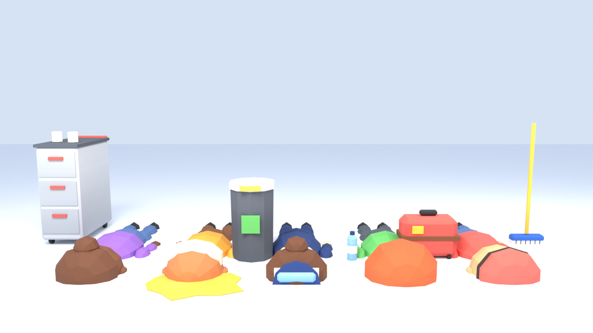
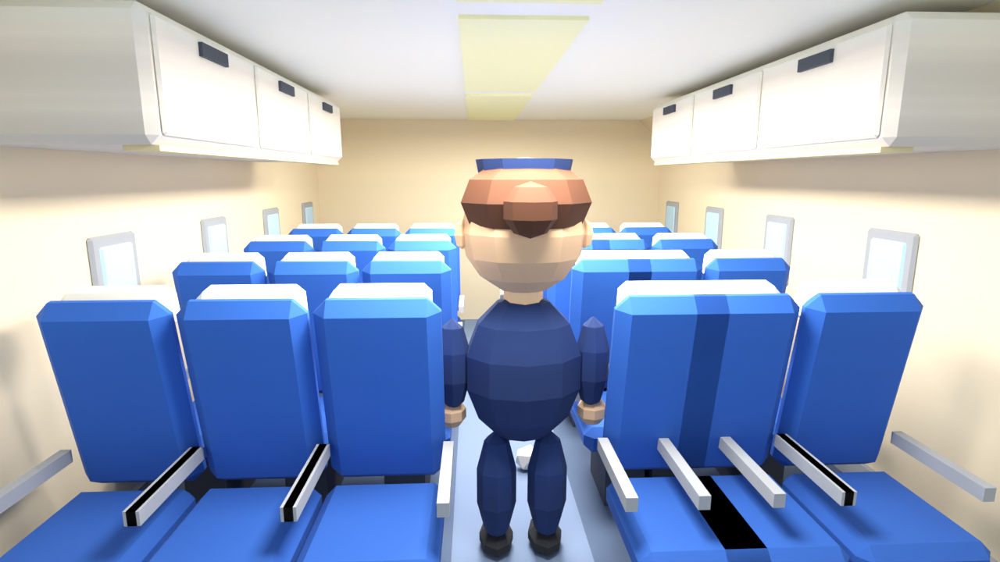
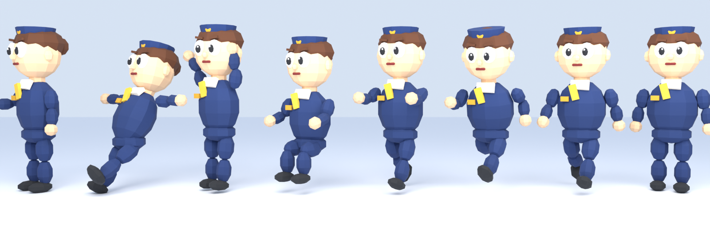

# SkyCrew (nome provisório)

Jogo 3D cartunesco de simulação caótica de passageiros: você é da tripulação de um avião comercial fictício
e precisa atender pedidos, organizar a cabine e lidar com turbulência, com comédia física e (no futuro)
cooperação online.

- **Engine:** Unity 6 (6000.x) · C# · URP · Input System
- **Plataforma inicial:** Windows PC
- **Estado:** Fases 0, 1 e 2 implementadas, mais salvamento/progressão e personagens com esqueleto e animações (início da Fase 3). Regras testadas (113 testes); **ainda não executado no Editor da Unity** (veja *Estado real*)





*Prévias renderizadas no Blender a partir dos próprios FBX que a Unity importa.*

## Estado real

| Sistema | Estado | Evidência |
|---|---|---|
| Ciclo da partida (estados, transições, resultado único, reinício, vitória no pouso) | Implementado e testado | 23 testes EditMode |
| Tarefas (objetivos modulares, alvo por instância, prazo, dependências, recompensa única, bônus de resposta rápida) | Implementado e testado | 17 testes |
| Passageiros: necessidades (sede, fome, frio, medo, banheiro), 7 personalidades, estados, desistência de pedido, limite de pedidos | Implementado e testado | 19 testes |
| Personalidades com efeito: prestativo acalma vizinhos, desastrado derruba coisas | Implementado e testado | 2 testes |
| 7 eventos (turbulência, objeto derrubado, derramamento, corredor bloqueado, geladeira quebrada, mala caída, passageiro assustado) | Implementado e testado (regras) | 15 testes |
| Pontuação (fórmula documentada, estrelas calibradas por simulação) e regras de interação | Implementado e testado | 8 testes |
| Viagem completa do protótipo (obrigatórias, vitória no pouso, derrota, reinício) | Implementado e testado (regras) | 4 testes |
| **Loop principal**: 40 viagens completas seguidas sem travar + calibragem | Testado (regras) | 5 testes (`LoopSoakTests`) |
| Jogador, interação, física, NavMesh, HUD, pausa, resultados | Implementado, **compila**, não executado | `verificar.sh` |
| Mancha + esfregão (com escorregão), carrinho puxável que bloqueia o corredor, conserto da geladeira, gavetas de lanche/cobertor | Implementado, **compila**, não executado | `verificar.sh` |
| Cena do protótipo e configuração URP | Preparados; **exigem o Editor** | `SkyCrew > ...` |
| Salvamento (versão, checksum, migração, corrompido/ausente, gravação atômica) e progressão (estrelas, recorde, 8 desbloqueios, sem duplicar) | Implementado e testado | 20 testes |
| Modelos 3D (cabine modular, 10 props) | Gerados e validados no Blender | reimportação dos FBX |
| Personagens com esqueleto (nomes Humanoid, skinning rígido) e 9 animações (parado, andar, correr, carregar ×2, sentado, pânico, escorregar, falar) | Gerados e validados no Blender (pesos, loops, direção do passo, poses) | `gerar_personagens.py` |
| Animator Controller (gerado no Editor) + driver com reserva procedural | Implementado, **compila**; precisa do menu *SkyCrew > 5* no Editor | — |
| Testes PlayMode (5) | Escritos e **compilam**; rodam só na Unity | — |
| Áudio, menu principal, multiplayer | Ainda não implementados | ROADMAP |

## Como abrir e jogar

1. Instale a **Unity 6** (qualquer 6000.x LTS) pelo Unity Hub e use **Add project from disk** nesta pasta `SkyCrew/`.
   O projeto não traz `ProjectVersion.txt`; o Hub pergunta a versão.
2. Aguarde o Package Manager instalar URP, Input System e Test Framework (`Packages/manifest.json`).
   Se a versão de algum pacote não existir na sua Unity, aceite a versão sugerida.
3. Quando a Unity perguntar se quer ativar o novo Input System, clique **Yes** (o Editor reinicia).
   Confira em *Project Settings > Player > Active Input Handling* = **Input System Package (New)**.
4. Menu **SkyCrew > 1. Configurar projeto (URP)**.
5. Abra `Assets/_Project/Scenes/Aircraft/Prototype.unity` e aperte **Play**.
   Se a cena não abrir, use **SkyCrew > 2. Recriar cena do protótipo**.
6. **SkyCrew > 5. Gerar Animator dos personagens** (sem isso, os personagens usam a animação procedural provisória).
7. Opcional: **SkyCrew > 3. Validar recursos 3D** (relatório no Console) e **SkyCrew > 4. Criar dados padrão**.

O progresso fica em `Application.persistentDataPath/skycrew.save`, um arquivo texto com checksum. Se ele estiver danificado, o jogo começa do zero e guarda uma cópia em `skycrew.save.corrompido`.

### Controles

WASD mover · Mouse câmera · Shift correr · Espaço pular · **E** interagir (sem alvo: soltar) · **Tab** detalhes das tarefas · **Esc** pausar. Controle de videogame também é mapeado.

### Objetivo da viagem do protótipo

O voo dura 4 minutos e você vence ao **pousar** com as 3 tarefas obrigatórias feitas:
1. **Embarque (30 s):** guarde a **mala esquecida** no corredor num bagageiro. A Lia embarca e caminha até a 2F.
2. **Em voo:** a Bia pede **água**. Pegue na geladeira da cozinha e entregue.
3. Aos 25 s de voo vem a **turbulência**: o aviso de cinto acende, objetos voam, você tropeça e o Otto entra em pânico. **Converse** com ele.

Durante o voo inteiro surgem pedidos (água, lanche, cobertor) e imprevistos, cada um com sua tarefa:

| Imprevisto | O que fazer |
|---|---|
| Objeto derrubado (o desastrado derruba mais) / lixo da turbulência | Pegar e jogar na lixeira da cozinha |
| Derramamento no corredor | Pegar o esfregão (armário do fundo) e esfregar 3 vezes. Correr por cima faz escorregar! |
| Corredor bloqueado pelo carrinho | **E** para segurar a alça e levar até a cozinha. Enquanto isso os passageiros não passam |
| Geladeira quebrada | Dar 3 batidas nela (**E**); até lá não sai água |
| Mala caiu do bagageiro | Guardar de novo |
| Passageiro assustado | Conversar |

Passageiros ignorados desistem do pedido e ficam mais impacientes. O Rui (prestativo) acalma quem está com medo por perto. Resolver rápido (até metade do prazo) rende +25%. Você perde se uma tarefa obrigatória falhar, se a satisfação da cabine despencar ou se o avião pousar com obrigatórias pendentes.

## Testes e verificação

- **Na Unity:** *Window > General > Test Runner* → EditMode (113 testes de regras) e PlayMode (5 testes de cena).
- **Sem a Unity** (Linux/Mac/Windows com .NET 8):
  ```bash
  Tools/Verificacao/verificar.sh
  ```
  Esse comando roda os testes EditMode com `dotnet test`. Também compila o código Unity (Runtime, Editor e testes PlayMode) contra as DLLs de referência da Unity baixadas do NuGet. Detalhes e limites estão em [Docs/TEST_PLAN.md](Docs/TEST_PLAN.md).

## Modelos 3D

Gerados por script no Blender (sem recursos de terceiros):

```bash
blender --background --python Tools/Blender/gerar_modulos.py      # cabine e props + textura + validação
blender --background --python Tools/Blender/gerar_personagens.py  # personagens com esqueleto + animações + validação
blender --background --python Tools/Blender/gerar_personagens.py -- previa   # prévia das poses
blender --background --python Tools/Blender/renderizar_previa.py  # prévias em Tools/Blender/previas
```

## Documentação

[Arquitetura](Docs/ARCHITECTURE.md) · [Decisões técnicas](Docs/TECHNICAL_DECISIONS.md) · [Plano de testes](Docs/TEST_PLAN.md) ·
[Recursos 3D](Docs/ASSET_MANIFEST.md) · [Problemas conhecidos](Docs/KNOWN_ISSUES.md) · [Roadmap](Docs/ROADMAP.md)

## Originalidade

O gênero (simulação caótica em avião) tem como referência geral jogos como *Dear Passengers*. Nenhum recurso,
personagem, texto ou identidade visual desse jogo foi usado. Todos os modelos, textura, código e textos foram
criados para este projeto.
